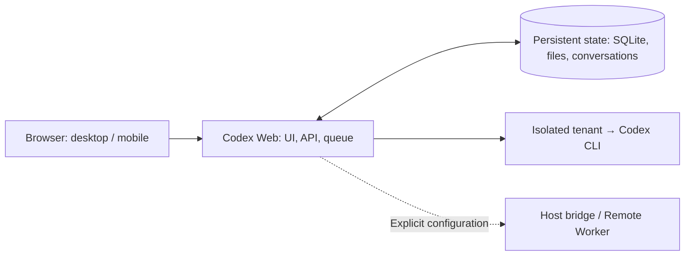

# Codex Web

[中文（默认）](README.md) · **English**

A self-hosted browser workspace for Codex CLI. Start tasks from a computer or phone, work with projects and files, and return later to inspect their results.

Conversations, drafts, attachments, queued requests and execution records persist on your server. The base installation uses username/password login and runs Codex under a separate, unprivileged tenant identity. Configure extensions individually when you need other computers, voice transcription or remote cold storage.

> Codex Web is an independent community project. It is not affiliated with, endorsed by, or supported by OpenAI.

[Quick start](#quick-start) · [Optional capabilities](#optional-capabilities) · [Documentation](#documentation) · [Cloud deployment runbook](AI_CLOUD_DEPLOYMENT_RUNBOOK.md)

## What you can do

| Use case | Current capabilities |
| --- | --- |
| Continue working over time | Persistent conversations and drafts, editable/reorderable pending prompts, live work journals, interruption summaries, archive and restore |
| Long-running work and automation | One-shot timed/event-driven continuation; project schedules, time zones and execution history; live steering for Codex |
| Project work | Project directories, conversation moves, project skills and cross-project search; optional boards, opportunity cards and judgment book |
| Files and reading | Attachments and resumable uploads, Markdown/HTML/PDF/EPUB previews, questions about selected document text, math, revocable public links and sandboxed interactive HTML |
| Desktop and mobile | Responsive layout, draft restoration across devices, unread results, theme and text-size settings |
| Additional executors | Explicitly configured host bridges, Remote Workers and Gemini / Antigravity on supported nodes |

Models and reasoning levels come from the selected executor's authenticated catalog. Live Codex steering requires the same model and reasoning level as the active request. Gemini / Antigravity additions remain queued for the next request. Switching engines transfers bounded conversation context, not the complete native session.



## Quick start

These instructions cover the **Linux + Docker base installation** in a Bash terminal with Docker access. You need Git, Docker Engine, Compose v2, Buildx and an account that can sign in through Codex CLI. Host Node.js and npm development dependencies are not required.

Plan for at least 4 GB of RAM, or 8 GB or more for document-heavy work. Builds, upgrades and rollback copies need additional free disk space. The [build and capacity guide](docs/BUILD_AND_STORAGE.md) distinguishes image size, build peak and user data; its historical measurements are not a current installation-size guarantee.

### 1. Clone and build

```bash
git clone --branch main https://github.com/Raytto/codex-web.git
cd codex-web
./scripts/build-image.sh
cp .env.example .env
chmod 600 .env
```

Use `main`. The helper archives a selected Git commit, builds with a temporary resource-bounded Buildx builder and removes that builder's cache afterward. The default image is `codex-web:local`. Commit or preserve tracked local changes before building.

### 2. Generate a password hash and session secret

Enter a Web password of at least 12 characters; input is not echoed:

```bash
read -r -s -p 'Web password (at least 12 characters): ' web_password
printf '\n'
printf '%s' "$web_password" | docker run --rm -i --network none \
  --entrypoint node codex-web:local scripts/hash-password.mjs
unset web_password
```

Generate a separate random session secret:

```bash
docker run --rm --network none --entrypoint node codex-web:local \
  -e "console.log(require('node:crypto').randomBytes(32).toString('hex'))"
```

### 3. Edit your private `.env`

| Setting | Value |
| --- | --- |
| `APP_USERNAME` | Web login name, for example `admin`. Avoid the reserved name `owner` for an ordinary account if you may later enable the host bridge or Remote Worker |
| `APP_DISPLAY_NAME` | Display name |
| `APP_PASSWORD_HASH` | The generated bcrypt hash; wrap the complete value in single quotes in `.env` to prevent Compose interpolation of `$` |
| `SESSION_SECRET` | The generated random session secret |
| `PUBLIC_BASE_URL` | Keep `http://localhost:37821/codex-web` for local use; use the actual HTTPS URL, including `/codex-web`, for a public deployment |

Web login and Codex authorization are separate. Keep `.env` outside Git and leave unused voice, memory and host-bridge settings empty.

### 4. Initialize permissions and start

```bash
sudo chown 10001:10001 .env
sudo chmod 600 .env
sudo docker network inspect codex-web-egress >/dev/null 2>&1 \
  || sudo docker network create codex-web-egress
sudo docker compose config --quiet
sudo docker compose up -d --no-build
sudo docker compose ps
```

Use a privileged editor for later `.env` changes, and run Compose with `sudo` or as host root. The `init-state` service initializes data-directory permissions before the app starts. The Web process reads the private configuration; tenant execution uses a different Unix identity.

Once the app is healthy, check:

```bash
curl --fail http://127.0.0.1:37821/codex-web/api/health
```

### 5. Sign the base tenant into Codex

```bash
sudo docker compose exec --user 11001:11001 \
  -e HOME=/app/tenants/00000000-0000-4000-8000-000000000001 \
  -e CODEX_HOME=/app/tenants/00000000-0000-4000-8000-000000000001/codex-home \
  app codex login --device-auth
```

Complete the device authorization, then open **http://localhost:37821/codex-web/**. Sign in with the Web username from step 3 and the original password entered in step 2. Run a small task and verify file upload/download and persistence after a restart.

On a remote server, `localhost` refers to that server. For an initial trial, forward the local port:

```bash
ssh -L 37821:127.0.0.1:37821 user@your-server
```

For public access, configure an HTTPS reverse proxy using the [deployment guide](docs/DEPLOYMENT.md#reverse-proxy). Preserve `/codex-web/` and SSE/WebSocket support. The default port binds only to loopback.

## Optional capabilities

The base image contains the application, one pinned Codex CLI, Python/uv, Git and FFmpeg. An extension's presence in the source does not enable it automatically.

| Capability | Configuration |
| --- | --- |
| Office/PDF conversion and document libraries | Build `documents` for LibreOffice, Poppler, fonts and Python document/data packages; see [building and storage](docs/BUILD_AND_STORAGE.md) |
| Voice transcription | Set your own `DASHSCOPE_API_KEY`, HTTPS `DASHSCOPE_BASE_URL`, a supported `DASHSCOPE_ASR_MODEL` and HTTPS `PUBLIC_BASE_URL`; audio and bounded context go to that service |
| Personal-memory extraction | Set `PERSONAL_MEMORY_API_KEY`, `PERSONAL_MEMORY_BASE_URL` and a model; no external extraction runs without configuration |
| Host bridge / Remote Worker | Select trusted executors and configure identities and paths; see [deployment options](docs/DEPLOYMENT_OPTIONS.md) and the [Worker guide](remote-worker/README.md) |
| Gemini / Antigravity | Explicitly add and authorize an account on a supported, configured node; the base image contains no extra model CLI; see [multi-engine execution](docs/MULTI_ENGINE.md) |
| Cold storage / shared Codex authentication | Supply the storage provider and encryption keys, or reviewed authentication source/policy, respectively; no cloud account, keys or login state are bundled |
| Project boards, opportunity cards and judgment book | Enable through per-account feature selection; no private projects, topics or business records are shipped |

To include document tools:

```bash
CODEX_WEB_BUILD_TARGET=documents ./scripts/build-image.sh
```

The build helper reads exported shell variables, not the Compose `.env`. The example's `transcription-model` and `memory-model` are placeholders: replace them with models your provider supports. See the [deployment-options guide](docs/DEPLOYMENT_OPTIONS.md) for complete setup and acceptance checks.

## Task and data persistence

- Each conversation is serial; different conversations may run concurrently. Regular-account jobs are subject to global, per-user and per-executor limits such as `MAX_GLOBAL_RUNNING_JOBS`, `MAX_RUNNING_JOBS_PER_USER` and `MAX_RUNNING_JOBS_PER_EXECUTOR`.
- Closing a browser does not delete server-side queued work, drafts or files. Continuation plans survive service restarts. A forcibly interrupted model process leaves recovery records; arbitrary processes are not guaranteed to resume automatically from their interruption point.
- Default state lives under `.state/data` and `.state/tenants`, including SQLite, account-isolated files and Codex login/session state. Back up these directories independently of source code.
- Default Compose mounts no Docker socket or host project directory and starts no host-root bridge. Read the [security model](docs/SECURITY.md) before enabling trusted executors.

The browser handles interaction, the server persists state, and the selected executor runs the work. See [architecture](docs/ARCHITECTURE.md) for details.

## Updates and development

Back up state and `.env` before upgrading, and read the relevant [deployment and migration guidance](docs/DEPLOYMENT.md#updating). From a clean `main` checkout:

```bash
git pull --ff-only
./scripts/build-image.sh
sudo docker compose up -d --no-build
```

For managed publication, opt in to `deploy/codex-web-request-rebuild` and `deploy/codex-web-rebuild-coordinator`, or install the `codex-web-self-maintain.service` / `.path` templates. The base installation does not enable them. Publication queues, status and rollback material remain in operator state.

Local development requires **Node.js ≥ 22.13.0**. Configure a local `.env`, then run:

```bash
npm ci
npm run lint
npm test
npm run dev
```

The development URL is `http://127.0.0.1:5173/codex-web/`. `npm test` builds and tests the application. `npm run test:worker` is separate and requires dependencies installed under `remote-worker` first. See [CONTRIBUTING.md](CONTRIBUTING.md).

## Documentation

| Topic | Guide |
| --- | --- |
| New cloud server | [AI cloud deployment runbook](AI_CLOUD_DEPLOYMENT_RUNBOOK.md) |
| Image profiles, builds, disk and cleanup | [Building and storage](docs/BUILD_AND_STORAGE.md) |
| Deployment, reverse proxy, upgrades and backups | [Deployment](docs/DEPLOYMENT.md) · [Optional features](docs/DEPLOYMENT_OPTIONS.md) |
| Permissions and architecture | [Security](docs/SECURITY.md) · [Architecture](docs/ARCHITECTURE.md) |
| Continuation and project schedules | [Durable continuation](docs/WAKE_AUTOMATION.md) · [Recurring tasks](docs/PROJECT_RECURRING_TASKS.md) |
| Project and personal tools | [Project boards](docs/features/PERSONAL_KANBAN.md) · [Opportunity cards](docs/OPPORTUNITY_CARDS.md) · [Judgment book](docs/JUDGMENT_BOOK.md) |
| Reading and sharing | [Reader](docs/READER_PROGRESSIVE_LOADING.md) · [Public sharing](docs/PUBLIC_FILE_SHARING.md) · [Interactive HTML](docs/WEB_PRESENTATIONS.md) |
| Other executors and models | [Remote Worker](remote-worker/README.md) · [Gemini / Antigravity](docs/MULTI_ENGINE.md) |
| Most recent public feature update | [November 4, 2026 upgrade notes](docs/UPGRADE_20261104.md) |

This page follows the implementation on public `main`. Historical updates and migration details live in the linked guides.

## License

[MIT](LICENSE)
