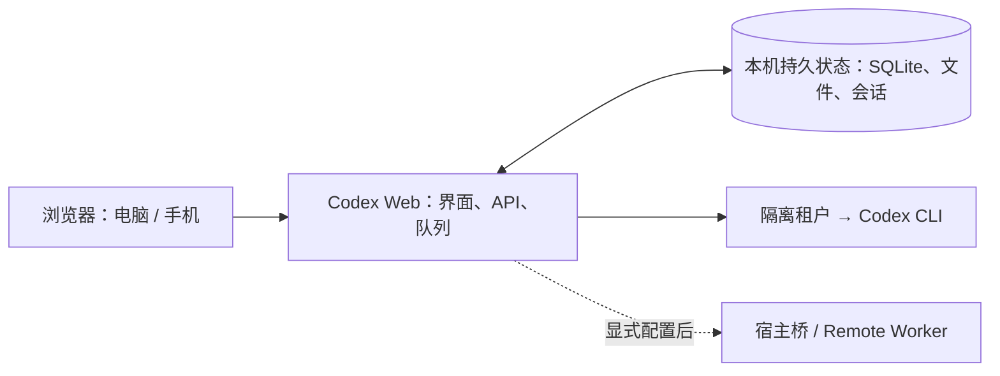

# Codex Web

**中文** · [English](README.en.md)

基于 Codex CLI 的自托管 AI 工作台：**语音交代需求，远程电脑执行，周期任务自动跑。**

在电脑或手机的浏览器里使用，会话、文件和执行记录保存在你自己的服务器上。语音、远程电脑等扩展按需配置。

> 本项目由社区独立开发，与 OpenAI 无隶属关系，未获得 OpenAI 的背书或支持。

[快速开始](#快速开始) · [可选能力](#可选能力) · [文档导航](#文档导航) · [云服务器部署手册](AI_CLOUD_DEPLOYMENT_RUNBOOK.md)

[从零配置到完整功能](docs/SETUP_GUIDE.zh-CN.md) · [本轮升级检查](docs/UPGRADE_20261114.md)

本次更新：仅附件发送、持续语音上下文与中断、远端引导对账、SQLite恢复及构建精简。升级前保留本实例数据与配置，升级后刷新网页。

## 主要能力

- **持续通话**：在原会话连续说话、打断播报并委派任务；使用独立、可选的 Live API。
- **长期总管**：PP Dot 跨项目派工、记录来源记忆并核对真实结果。
- **存储恢复**：可选加密分块、冷文件按需恢复和独立恢复演练。
- **语音输入**：说出需求，录音自动转写并交给 Agent。
- **远程电脑**：从网页给自己的电脑派任务，使用那台电脑的文件和工具，取回结果。
- **周期任务**：每天、每周或按间隔自动运行，定时巡检、整理资料、生成报告。
- **机会卡片**：按主题发现与筛选机会，用反馈调整推荐，再对感兴趣的卡片深入研究。
- **任务续跑**：定时唤醒或等待事件后继续，离开页面也能回来查看进度。
- **随时补充**：任务运行中追加要求、修正方向，待执行的任务可编辑和重排。
- **文档问答**：上传资料直接阅读，选中文字提问，预览和分享生成的报告。
- **多种引擎**：在同一个工作台中，按任务选择 Codex、Gemini 或 Antigravity。
- **项目工作区**：按项目管理会话、文件和技能，在电脑与手机间继续工作。

> **PP Dot · 长期总管**：已包含固定总管会话、跨项目与节点委派、台账、来源记忆与结果复核。显式授权宿主账号后启用；持续语音另外配置。

语音输入需配置转写服务；远程电脑需安装并授权 Remote Worker；机会卡片需在账号功能中启用；Gemini / Antigravity 需配置受支持的执行节点。详见[可选能力](#可选能力)。

## 快速开始

以下是 **Linux + Docker 的基础部署**，在可使用 Docker 的 Bash 终端执行。需要 Git、Docker Engine、Compose v2、Buildx，以及能够登录 Codex CLI 的账号；宿主无需安装 Node.js 或 npm 开发依赖。

建议至少准备 4 GB 内存，文档处理等较重任务使用 8 GB 或更多。构建、升级和回滚还需要额外磁盘空间；[构建与容量指南](docs/BUILD_AND_STORAGE.md)区分了镜像、构建峰值和用户数据，旧测量不代表当前安装大小。

### 1. 获取源码并构建

```bash
git clone --branch main https://github.com/Raytto/codex-web.git
cd codex-web
./scripts/build-image.sh
cp .env.example .env
chmod 600 .env
```

请使用 `main`。构建脚本从选定 Git 提交导出源码，使用有资源上限的临时 Buildx builder，并在结束时清理自己的构建缓存。默认生成 `codex-web:local` 基础镜像；已有本地修改应先提交或妥善保留。

### 2. 生成登录密码哈希和会话密钥

在终端输入至少 12 个字符的网页登录密码，输入不会回显：

```bash
read -r -s -p 'Web password (at least 12 characters): ' web_password
printf '\n'
printf '%s' "$web_password" | docker run --rm -i --network none \
  --entrypoint node codex-web:local scripts/hash-password.mjs
unset web_password
```

再生成独立的随机会话密钥：

```bash
docker run --rm --network none --entrypoint node codex-web:local \
  -e "console.log(require('node:crypto').randomBytes(32).toString('hex'))"
```

### 3. 编辑私有 `.env`

| 配置 | 填写方式 |
| --- | --- |
| `APP_USERNAME` | 网页登录名，例如 `admin`。若以后启用宿主桥或 Remote Worker，普通账号不要使用保留名 `owner` |
| `APP_DISPLAY_NAME` | 网页显示名称 |
| `APP_PASSWORD_HASH` | 上一步生成的 bcrypt 哈希；在 `.env` 中用单引号包住完整值，避免 `$` 被 Compose 插值 |
| `SESSION_SECRET` | 上一步生成的随机会话密钥 |
| `PUBLIC_BASE_URL` | 本机试用保留 `http://localhost:37821/codex-web`；公网部署改成包含 `/codex-web` 的实际 HTTPS 地址 |

网页登录与 Codex 授权是两回事。`.env` 只保存在自己的安装环境，不提交到 Git；未使用的语音、个人记忆、宿主桥等配置保持空值。

### 4. 初始化权限并启动

```bash
sudo chown 10001:10001 .env
sudo chmod 600 .env
sudo docker network inspect codex-web-egress >/dev/null 2>&1 \
  || sudo docker network create codex-web-egress
sudo docker compose config --quiet
sudo docker compose up -d --no-build
sudo docker compose ps
```

后续编辑 `.env` 使用有权限的编辑器，Compose 命令使用 `sudo` 或宿主 root。`init-state` 会先初始化数据目录权限，再启动应用；Web 进程读取私有配置，租户执行进程使用不同的 Unix 身份。

等待应用健康后检查：

```bash
curl --fail http://127.0.0.1:37821/codex-web/api/health
```

### 5. 为基础租户登录 Codex

```bash
sudo docker compose exec --user 11001:11001 \
  -e HOME=/app/tenants/00000000-0000-4000-8000-000000000001 \
  -e CODEX_HOME=/app/tenants/00000000-0000-4000-8000-000000000001/codex-home \
  app codex login --device-auth
```

按命令输出完成设备授权，再打开 **http://localhost:37821/codex-web/**，使用第 3 步的网页登录名和第 2 步输入的原始密码登录。先运行一个简单任务，并验证文件上传、下载和重启后的历史保留。

如果服务装在远程服务器上，`localhost` 指那台服务器。可以先用 SSH 端口转发进行试用：

```bash
ssh -L 37821:127.0.0.1:37821 user@your-server
```

公网访问请按[部署说明](docs/DEPLOYMENT.md#reverse-proxy)设置 HTTPS 反向代理，保留 `/codex-web/` 路径及 SSE/WebSocket 支持。默认端口仅绑定回环地址。

## 可选能力

基础镜像只提供主应用、一个固定版本的 Codex CLI、Python/uv、Git 和 FFmpeg 等基础运行工具。扩展按需配置；仓库包含实现不代表已经启用。

| 能力 | 启用条件与说明 |
| --- | --- |
| Office、PDF 转换及文档库 | 构建 `documents` 镜像，增加 LibreOffice、Poppler、字体和 Python 文档/数据包；见[构建指南](docs/BUILD_AND_STORAGE.md) |
| 语音转写 | 选择 DashScope 音频输入或 OpenAI 文件转写，分别配置自己的 API 账号与模型；音频和有界上下文发送到所选服务。见[录音转写配置](docs/VOICE_TRANSCRIPTION_PROVIDERS.md) |
| 个人记忆提取 | 配置 `PERSONAL_MEMORY_API_KEY`、`PERSONAL_MEMORY_BASE_URL` 及模型；未配置时不调用外部提取服务 |
| 宿主桥 / Remote Worker | 显式选择可信执行器、配置身份和路径；详见[分层部署](docs/DEPLOYMENT_OPTIONS.md)与[Worker 指南](remote-worker/README.md) |
| Gemini / Antigravity | 在已配置的受支持节点上显式添加账号并授权；基础镜像不附带额外模型 CLI；见[多引擎说明](docs/MULTI_ENGINE.md) |
| 冷存储 / 共享 Codex 认证 | 分别配置存储供应商与加密密钥，或认证来源与策略；默认不附带云盘、密钥或登录态 |
| 项目看板、机会卡片、判断簿 | 按账号在功能选择中启用；公开仓库不预置私人项目、主题或业务记录 |

需要文档工具时，使用相同构建入口：

```bash
CODEX_WEB_BUILD_TARGET=documents ./scripts/build-image.sh
```

构建脚本读取导出的 shell 环境变量，不能只修改 `.env` 就假定它会选择 `documents`。语音和记忆模型默认留空，启用时应填写本人账号实际支持的模型。完整配置与验收步骤见[分层部署与可选功能指南](docs/DEPLOYMENT_OPTIONS.md)。

模型及思考深度以所选执行器的实际账号目录为准。Codex 的运行中引导要求与当前任务使用相同模型和思考深度；Gemini / Antigravity 的补充消息排队等待下一轮。切换引擎会传递有界的历史上下文，不等于迁移整个原生会话。

## 任务和数据如何保存

- 同一会话串行，多会话可并行；普通账号调度受全局、用户、执行器等限制，相关配置包括 `MAX_GLOBAL_RUNNING_JOBS`、`MAX_RUNNING_JOBS_PER_USER` 和 `MAX_RUNNING_JOBS_PER_EXECUTOR`。
- 关闭浏览器不会删除服务器上的队列、草稿或文件。持久续跑计划可以跨服务重启保留；强制中断的模型执行会留下恢复记录，不保证任意进程能够从中断点自动继续。
- 默认状态位于 `.state/data` 和 `.state/tenants`，包括应用数据库、账号隔离的文件及 Codex 登录/会话状态。它们需要单独备份，不属于源码。
- 默认 Compose 不挂载 Docker socket 或宿主项目目录，也不启动宿主 root bridge。启用可信执行器前先阅读[安全模型](docs/SECURITY.md)。



浏览器负责交互，服务器持久化状态，所选执行器负责实际运行；更完整的关系见[架构说明](docs/ARCHITECTURE.md)。

## 升级与开发

升级前备份状态目录和 `.env`，阅读对应[部署与迁移说明](docs/DEPLOYMENT.md#updating)。在干净的 `main` 工作树中：

```bash
git pull --ff-only
./scripts/build-image.sh
sudo docker compose up -d --no-build
```

需要受管发布时，可选用 `deploy/codex-web-request-rebuild` 与 `deploy/codex-web-rebuild-coordinator`，或安装 `codex-web-self-maintain.service` / `.path` 模板；这些不会随基础安装自动启用。发布队列、状态及回滚材料留在部署者的状态目录。

本地开发需要 **Node.js ≥ 22.13.0**。填写本地 `.env` 后：

```bash
npm ci
npm run lint
npm run build
npm run dev
```

开发页面默认位于 `http://127.0.0.1:5173/codex-web/`。完整应用测试需要在隔离 Linux 测试环境中以维护权限运行，具体命令见 [CONTRIBUTING.md](CONTRIBUTING.md)；Worker 有独立的 `npm run test:worker` 入口，需要先安装 `remote-worker` 的依赖。

## 文档导航

| 需要了解 | 文档 |
| --- | --- |
| 新云服务器从零部署 | [AI 云服务器部署与运维手册](AI_CLOUD_DEPLOYMENT_RUNBOOK.md) |
| 镜像选择、构建、容量与清理 | [构建与存储](docs/BUILD_AND_STORAGE.md) |
| 部署、反向代理、升级与备份 | [部署说明](docs/DEPLOYMENT.md) · [可选功能](docs/DEPLOYMENT_OPTIONS.md) |
| 权限与系统结构 | [安全模型](docs/SECURITY.md) · [架构说明](docs/ARCHITECTURE.md) |
| 定时续跑与项目计划 | [持久续跑](docs/WAKE_AUTOMATION.md) · [项目周期任务](docs/PROJECT_RECURRING_TASKS.md) |
| 项目与个人辅助功能 | [项目看板](docs/features/PERSONAL_KANBAN.md) · [机会卡片](docs/OPPORTUNITY_CARDS.md) · [判断簿](docs/JUDGMENT_BOOK.md) |
| 文档阅读与分享 | [阅读器](docs/READER_PROGRESSIVE_LOADING.md) · [公开分享](docs/PUBLIC_FILE_SHARING.md) · [交互 HTML](docs/WEB_PRESENTATIONS.md) |
| 其他执行器与模型 | [Remote Worker](remote-worker/README.md) · [Gemini / Antigravity](docs/MULTI_ENGINE.md) |
| 最近一轮公开功能升级 | [本轮完整升级说明](docs/UPGRADE_20261114.md) |

本页按当前公开 `main` 的实现维护；历史更新和迁移细节放在专题文档中。

## 许可证

[MIT](LICENSE)

## 完整任务与实例配置

完整任务跨执行尝试、持久等待与补修保留归属。`MAX_ACTIVE_WORKFLOWS=-1` 默认不限完整任务数量；可显式设置正整数上限。单会话串行及 Job、执行器、内存、磁盘保护继续生效。详见[完整任务机制](docs/COMPLETE_WORKFLOWS.md)。

品牌、图标、主题及页面路径统一由实例环境配置提供，无需逐个修改前端文件；公开前端只接收白名单品牌字段。修改后重建容器即可应用运行配置。详见[配置来源与优先级](docs/INSTANCE_CONFIGURATION.md)。
